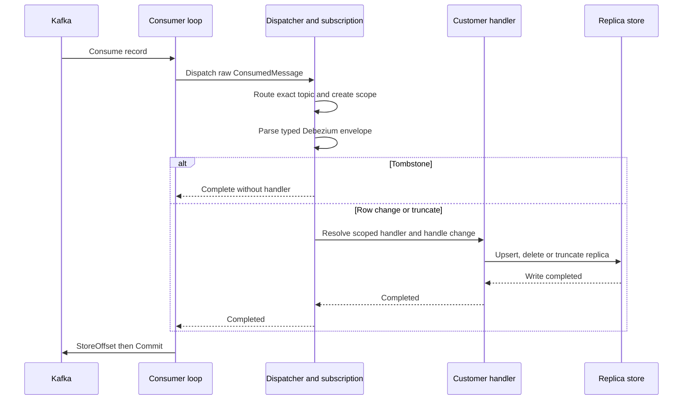
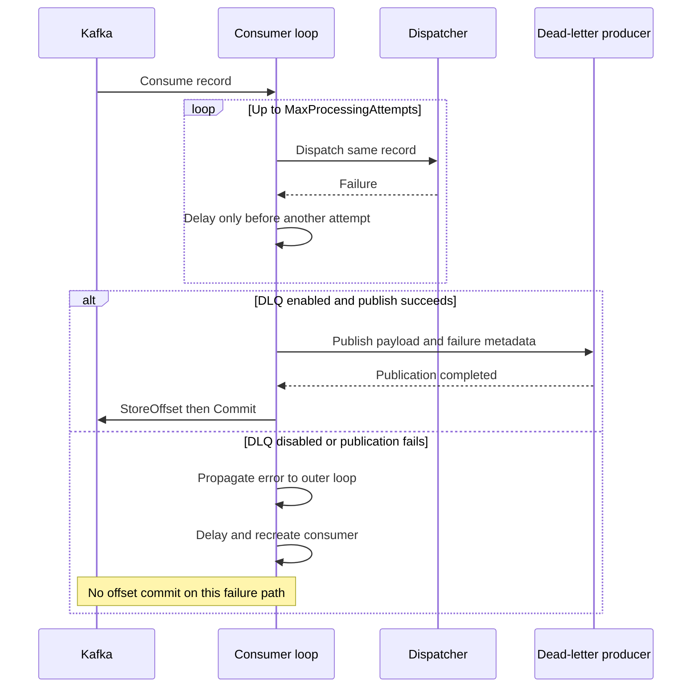
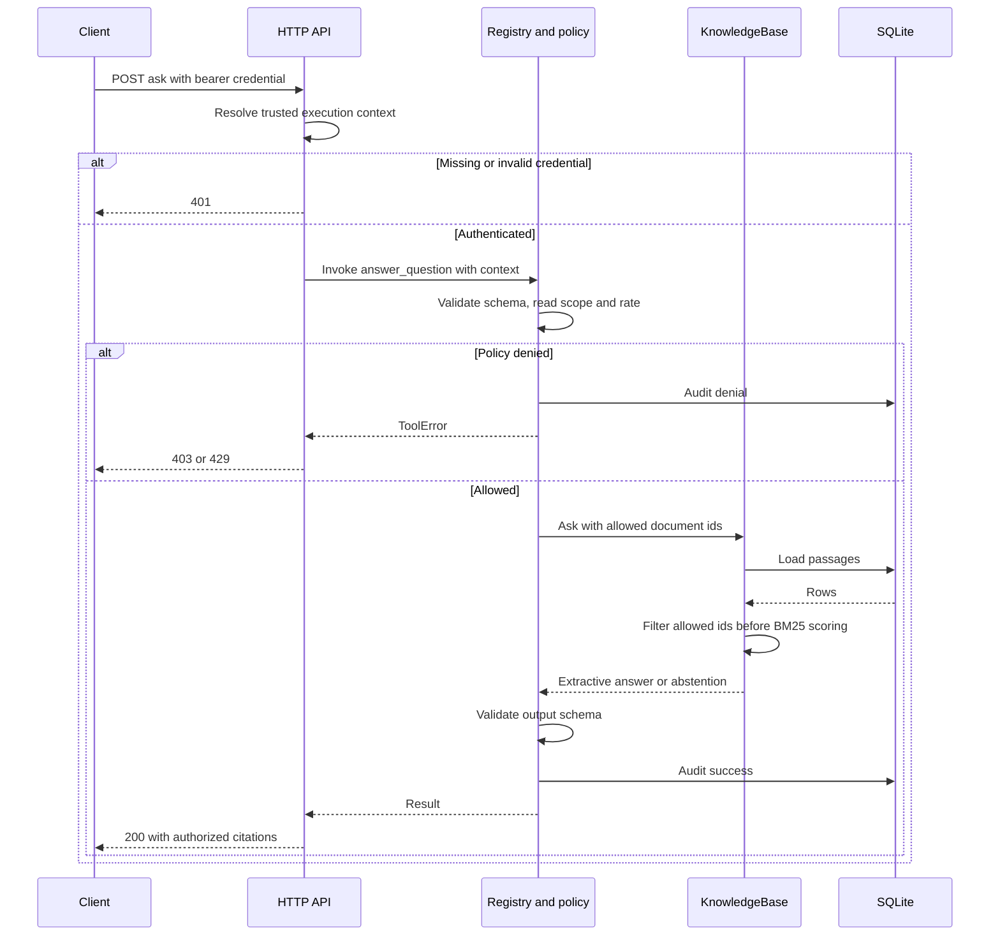
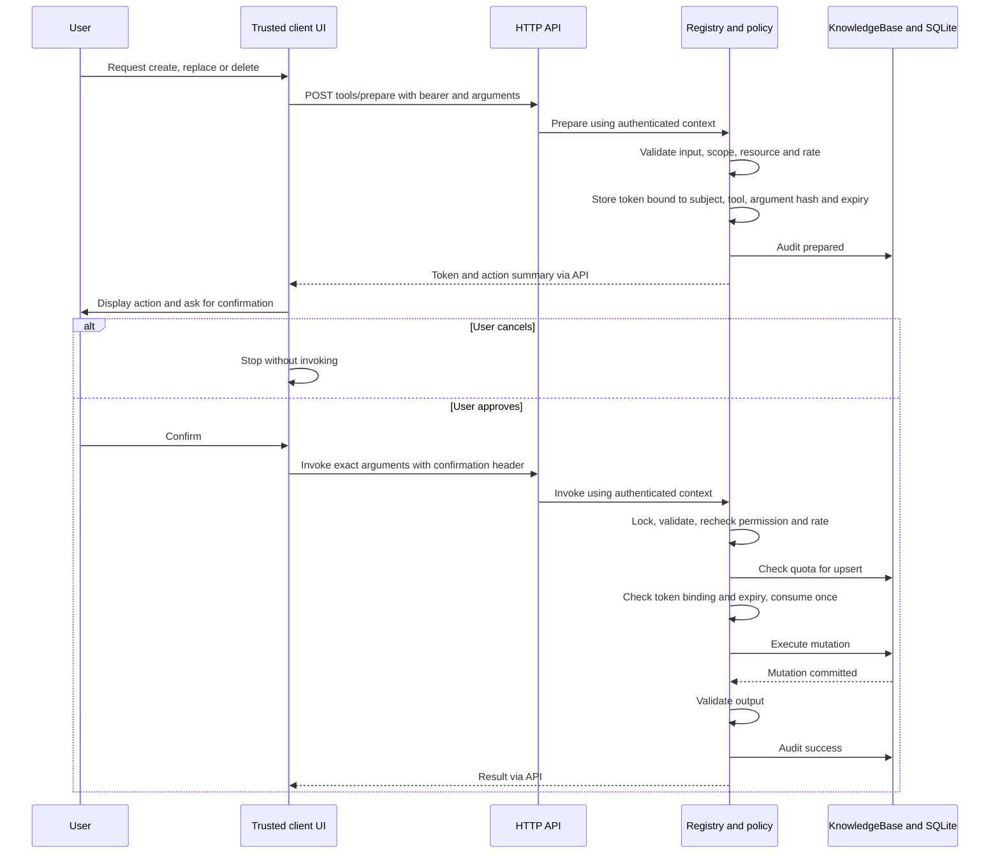
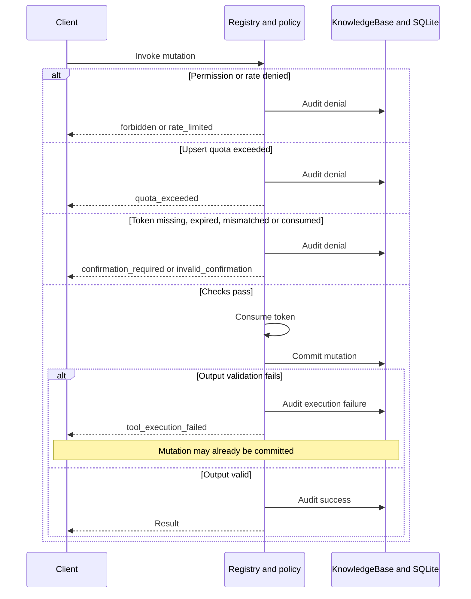

# Runtime sequence diagrams

These diagrams describe implemented behavior documented on 2026-11-02.
[ADRs](adr/README.md) explain decisions and alternatives. Arrows are logical calls,
not distributed transaction guarantees. Each diagram keeps at most five participants.

## CDC dispatch and projection

Each retry repeats dispatch with a new scope. Parsing belongs to the subscription,
not the consumer loop. Only the success branch is shown here; exceptions follow
the next diagram. Writes and offset commits are separate, so replay is possible.

## CDC retries and dead letters

This depicts a record that fails on every attempt. Earlier success skips DLQ and
commits normally. Commit failure after a write or DLQ publication can replay work.
Cancellation propagates without intentionally dead-lettering the cancelled action.

## Authorized document question

Invalid input is 400. Unexpected execution/output errors are sanitized as 500.
The in-process lock covers policy and KB execution. HTTP authentication failures
occur before dispatcher audit. SQLite reads still load the corpus before filtering.

## Confirmed tool mutation

Current UI implements this interaction for saving documents; API clients implement
it for deletes as well. Quota checking is only for upsert. Permission checks are
repeated for prepare and invoke. Audit is not atomic with mutation. A token proves
the protocol step, not independent human presence. Cancelled tokens expire in RAM.

## Mutation rejection and uncertain outcomes

The diagram assumes audit writes succeed. Audit failure can itself prevent a response;
there is no atomic action/result ledger. A lost HTTP response also leaves the caller
uncertain. Do not blindly retry with a new confirmation: inspect document state first.
A consumed token is never restored automatically. See [ADR 0005](adr/0005-tool-action-security.md).
